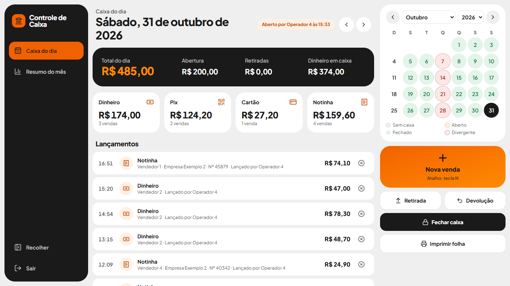
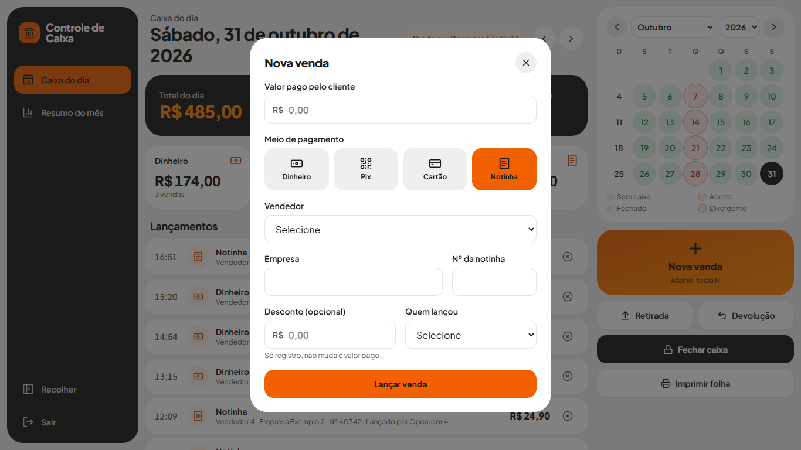
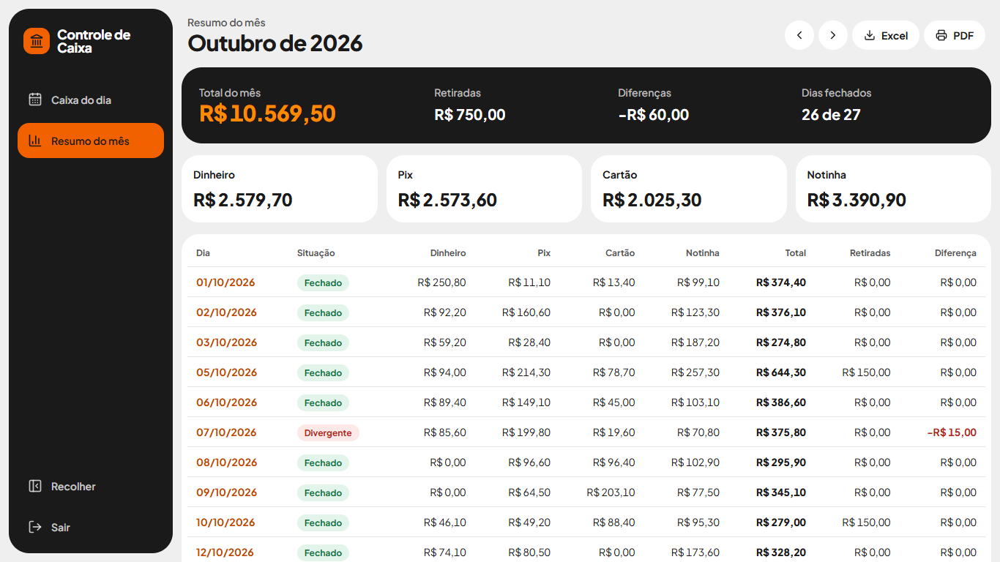

# Controle de Caixa

Sistema web para o caixa diário de um pequeno comércio. Substitui o controle em papel e calculadora:
abertura, vendas por meio de pagamento, retiradas, cancelamentos, devoluções, fechamento com senha e
resumo mensal.

Projeto de estudo, criado com apoio de IA (Claude Code). Eu defini o problema, as regras de negócio e
revisei cada decisão. A IA escreveu o código e os testes a partir dessas regras.

## Telas



| Nova venda | Resumo do mês |
| --- | --- |
|  |  |

Os dados das imagens são fictícios.

## O que faz

- **Calendário do mês** com a situação de cada dia: sem caixa, aberto, fechado ou com divergência.
- **Vendas** em dinheiro, Pix, cartão e notinha (venda a prazo com empresa e número), com vendedor,
  operador e desconto só para registro.
- **Totais por meio de pagamento** na tela, com filtro por clique.
- **Retiradas, cancelamentos e devoluções**, sempre com motivo e responsável.
- **Fechamento com senha**: o operador conta só o dinheiro, e o sistema mostra sobra ou falta.
  O dia fechado fica bloqueado, e reabrir exige a senha.
- **Resumo do mês** com exportação em CSV (abre no Excel) e impressão em PDF.
- **Acesso por CNPJ e senha**, com bloqueio de 5 minutos depois de 5 tentativas erradas.

Regra do dinheiro esperado: `abertura + vendas em dinheiro − retiradas − devoluções em dinheiro`.

## Tecnologias

Next.js 16 (App Router, Server Actions), React 19, TypeScript, Tailwind CSS 4, PostgreSQL no Supabase
(driver `postgres`), sessão com JWT (`jose`), senha com `bcryptjs`, testes com o runner do Node.

## Decisões de projeto

- **Dinheiro em centavos inteiros**, para não ter erro de arredondamento.
- **Fuso America/Sao_Paulo** em toda a lógica de dia, mesmo com o servidor em UTC.
- **Nada é apagado**: venda errada é cancelada com motivo, e cada ação vai para uma tabela de auditoria.
- **Regras no servidor**: o servidor recusa lançamento em dia fechado, mesmo que a tela mande.
- **Banco só pelo servidor**: o RLS do Supabase fica ligado e sem políticas, então as chaves públicas
  não leem nada.
- **Banco local embutido** (PGlite) para desenvolver sem conta em nenhum serviço.

## Rodar no computador

Sem `DATABASE_URL`, o sistema usa um banco embutido na pasta `.data`.

```bash
npm install
npm run preparar
npm run dev
```

`npm run preparar` cria as tabelas e pede o CNPJ e a senha de acesso. Os nomes de operadores e vendedores
do exemplo ficam na tabela `operadores` e `vendedores` (`db/schema.sql`).

```bash
npm test
```

## Demonstração online

Com `NEXT_PUBLIC_DEMO=1`, a tela de login mostra o acesso de exemplo. `npm run demo` cria as tabelas, define o
acesso de exemplo e carrega 40 dias de dados fictícios. O comando apaga os lançamentos do banco, então ele
recusa qualquer banco que já tenha outro acesso cadastrado.

## Publicar

1. Crie um projeto no [Supabase](https://supabase.com) e copie a connection string do **Transaction
   pooler** (porta 6543), com `?sslmode=require` no final.
2. Crie o `.env.local` a partir do `.env.example` com `DATABASE_URL` e `SESSION_SECRET`.
3. Rode `npm run preparar` para criar as tabelas e a senha de acesso.
4. Importe o projeto no [Vercel](https://vercel.com) e cadastre as mesmas variáveis.

O pooler do Supabase pode deixar sem resposta consultas simultâneas. Por isso `lib/db.ts` envia as
consultas uma por vez.

## Aviso

Dados e nomes do exemplo são fictícios. O sistema não emite nota fiscal e não substitui a contabilidade.
